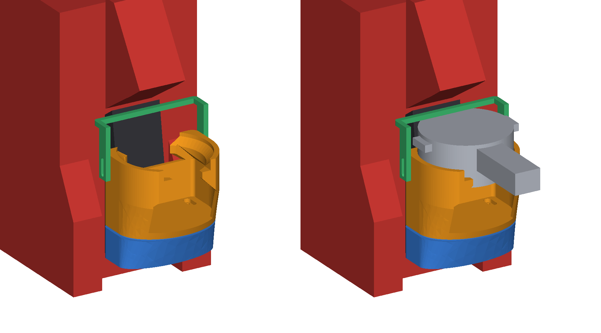

# Sideways Load Cell + Portafilter Cradle (Eureka Mignon Specialità)

⚠️ **Experimental: modelled and checked in CAD, not yet test-printed.** ⚠️

[](preview.png)

## Overview

An alternative to the cup holder for grinding straight into a 58mm portafilter. The load cell is turned 90° so it lies across the grinder, hidden in a closed box under the portafilter, instead of pointing forward out of the front. The portafilter drops into a round cradle on top.

- The cross mount and the cradle share one curved hull, so they read as one body with a 2 mm shadow line between them. The front draws in towards the bottom, from 86 mm at the top to 71 mm at the base.
- The whole assembly reaches 86 mm in front of the grinder face, about the same as the portafilter head it holds (the stock load cell reaches 83 mm).
- The stock **back plate, cover and screen adapter are unchanged**. Nothing is reprinted and the mod is reversible.
- The stock cup holder and its hole cover are not used.

## Parts

| Part | Files | Description |
|------|-------|-------------|
| **Cross mount** | [STL](Cross%20mount.stl) / [STEP](Cross%20mount.step) | Stub that bolts into the stock load cell seat, plus a tray that holds the load cell sideways. Its front is an open shell that continues the cradle's shape downward |
| **Hold-down** | [STL](Hold-down.stl) / [STEP](Hold-down.step) | U-shaped rest over the back of the portafilter rim, on two slotted stems. Stops the handle's weight tipping the portafilter; height is set once with two screws |
| **Portafilter cradle** | [STL](Portafilter%20cradle.stl) / [STEP](Portafilter%20cradle.step) | Lid over the load cell with two curved walls and a funnel-shaped seat the portafilter drops into |

`model.py` is the parametric [CadQuery](https://github.com/CadQuery/cadquery) source for both parts. All dimensions are parameters at the top of the file.

## Hardware

- T70 load cell, 1 kg (70 × 15 × 22 mm, M3 hole pairs 7 mm apart, 6 mm from each end)
- 4× M3 × 10 mm screws (2 fixed end, 2 free end)
- 2× M3 nuts (captive in the stub)
- 2× M3 × 12 mm screws with washers (hold-down; they cut their own thread in the cradle's pilot holes)
- The 2 stock seat screws

## Printing

- Print all parts in the STL orientation, flat side down, **no supports** (the hold-down prints upside down, bridge on the bed)
- 0.2 mm layers, 4 perimeters, 15–20% infill
- PETG preferred, PLA works

## Assembly

1. Slide two M3 nuts into the slot through the stub, one over each screw hole.
2. Drop the load cell into the tray with its cable end at the notched corner. Fix it with two M3 × 10 screws from underneath.
3. Push the stub into the stock load cell seat through the cover opening. Fasten it with the two stock seat screws from below into the nuts.
4. Run the cable through the notch into the cover opening to the HX711.
5. Set the cradle on top and fix it with two M3 × 10 screws into the free end of the load cell. The screws sit under the seat, so reach them with an L-shaped hex key through the open front.
6. Fit the hold-down: slide its two stems over the cradle's side walls and start an M3 × 12 screw with a washer through each slot into the pilot hole. Leave them loose.
7. Set the height: put the portafilter in the funnel and hold it level, lower the hold-down until it rests on the back of the rim, lift it about half a millimetre, and tighten both screws.
8. Check that the cradle and hold-down touch nothing but each other and the load cell (2 mm gap to the cross mount all round), then recalibrate (Menu → Calibrate).

## How the Portafilter Is Held

- **Funnel seat:** the seat is a 45° funnel with a short straight wall above it. The portafilter drops in from above and centres itself, resting wherever its body is between 61.5 and 73 mm wide. A flat-bottomed head sits near the top of the funnel; a bowl-shaped one sits a little lower.
- **Hold-down over the rim:** the handle's weight tips the portafilter forward, so the back of its rim comes up against the hold-down and it sits level. This is the same principle as the stock Eureka fork, and like that fork the height is set once with slotted screws (12 mm of travel), so any head height fits.
- **Ears sit above the cradle** and can be at any angle.
- **Open front:** the handle passes through a slot at the top, and the front below it is open so spouts are visible.
- **Closed floor:** stray grounds collect on the cradle floor. Brush or tip them out now and then; the firmware tares before every grind, so build-up does not affect accuracy.
- **To use:** with the handle raised a little, tuck the back of the rim under the hold-down, then lower the handle so the head drops into the funnel. To remove, lift the handle and pull forward.

## Fit and Limits

- **Portafilter:** any 58mm portafilter with a head up to 72–73 mm wide: spouted or bottomless, any ear layout, any head height.
- **Rear ear:** an ear pointing directly opposite the handle ends up about 1 mm from the stock cover and may touch it.
- **Highest hold-down setting:** at the top of its travel the hold-down comes within about 1 mm of the stock back plate's top tab. Check it does not touch.
- **Weight:** the hold-down adds about 6 g. The cradle weighs roughly 45 g at 15–20% infill (76 g printed solid), so a portafilter over roughly 700 g gets close to the 1 kg load cell limit.
- **Load cell cable:** there is 3 mm between each end of the load cell and the tray wall. The cable leaves through the notch at the fixed-end corner.
- **Basket position:** the basket centre is 2.5 mm further forward than the stock cup holder, so a 72 mm head clears the cover by about 4 mm.
- **Overload:** the tray floor sits 1 mm under the free end of the load cell as a downward stop. There is no upward stop.
- **Dimensions source:** load cell and grinder geometry are taken from the Fusion 360 design in `3d_files/smart-grind-by-weight. Eureka Mignon.f3z`, not measured on hardware. Real clearances may differ by a millimetre or two.

## Adjusting

Edit the parameters in `model.py` and regenerate:

```bash
pip3 install cadquery
python3 model.py   # writes STL and STEP files to ./out
```

Most useful parameters:

- `PF_R`: seat pocket radius (largest head that fits)
- `BASKET_GAP`: funnel throat (what has to pass through below the head)
- `LEDGE_Z`: height of the seat
- `PF_Y`: basket centre, front to back
- `FRONT_Y`: how far forward the cradle supports the head
- `HD_TRAVEL`, `HD_SCREW_Z`: hold-down adjustment range and screw height
- `HULL_B0`, `HULL_Z1`: how far the front draws in at the bottom, and the height where the curve starts
